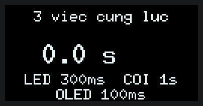
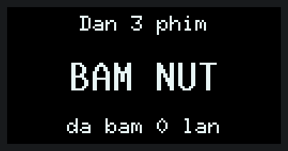
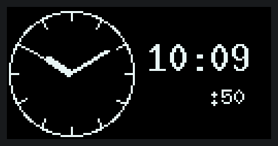
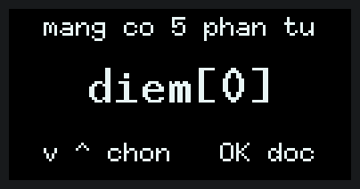
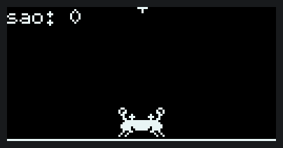

# ak-mcu-rust — firmware Rust trên AK MCU KIT

<p align="center">
  <a href="https://github.com/hohoanganh/ak-mcu-rust/actions/workflows/ci.yml"></a>
  <a href="https://github.com/hohoanganh/ak-mcu-rust/commits/main"></a>
  <a href="https://github.com/hohoanganh/ak-mcu-rust/blob/main/rust-toolchain.toml"></a>
  <a href="https://embassy.dev"></a>
  <a href="https://github.com/hohoanganh/ak-mcu-base"></a>
  <br>
  <a href="https://github.com/hohoanganh/ak-mcu-rust/tree/main/bai"></a>
  <a href="https://github.com/hohoanganh/ak-mcu-rust/blob/main/Cargo.toml"></a>
  <a href="https://github.com/hohoanganh/ak-mcu-base"></a>
  <a href="https://claude.com/claude-code"></a>
</p>

Chuỗi bài Rust nhúng cho người đang viết C, chạy trên AK MCU KIT (STM32L151, 128 KB flash, 32 KB RAM). Bài Rust chạy
**sau bootloader C** của [ak-mcu-base](https://github.com/hohoanganh/ak-mcu-base), nên kit luôn quay về firmware C được.
Mọi bài đã chạy trên kit thật.

## Rust cho thêm gì so với C?

| Ở C | Ở Rust | Xem |
|---|---|---|
| Đọc vượt mảng: ra rác, chạy tiếp | dừng đúng dòng, OLED hiện `PANIC main.rs dong 34` | bài 5 |
| Message là byte, bên nhận tự ép kiểu | channel có kiểu: gửi nhầm là không build được | bài 4 |
| Mã trả về dễ quên kiểm | `Result` buộc xử lý lỗi | bài 4 |
| Việc nhiều bước chia thành task + signal + timer | `async`: viết tuần tự từ trên xuống | bài 1–3 |
| Test hàng nghìn đầu vào ngẫu nhiên phải tự dựng | `proptest` có sẵn, tự thu nhỏ ví dụ hỏng | [`ak-boot`](ak-boot/tests/tinh_chat.rs) |

Không cần viết lại firmware C: hai module Rust chạy bên trong nó qua [`ak-ffi`](ak-ffi/). Bộ tách khung nạp firmware
chỉ tốn thêm 312 B. Bộ tách yêu cầu Modbus ([`ak-modbus`](ak-modbus/)) thay thư viện C nanoMODBUS, firmware nhỏ đi 3,4 KB,
và trả lời giống thư viện đó từng byte trên 20 000 yêu cầu ngẫu nhiên.

## Các bài

Tất cả bài nằm trong [`bai/`](bai/). Cột bên phải là màn hình OLED 128×64 của kit khi bài chạy.

| Bài | Nội dung | Màn hình OLED |
|---|---|---|
| 0 [`blink`](bai/blink/) | Nháy LED bằng cách ghi thẳng thanh ghi, không thư viện | không dùng màn hình |
| 1 [`hello-async`](bai/hello-async/) | Chờ mà không chặn: LED nháy và đếm giây cùng lúc | không dùng màn hình |
| 2 [`ba-viec-cung-luc`](bai/ba-viec-cung-luc/) | Ba việc ba nhịp: LED, còi, đồng hồ trên OLED |  |
| 3 [`nut-bam`](bai/nut-bam/) | Chờ sự kiện: đàn ba phím |  |
| 4 [`dong-ho`](bai/dong-ho/) | Hai task nói chuyện qua channel: đồng hồ kim từ RTC |  |
| 5 [`an-toan`](bai/an-toan/) | Đọc vượt mảng: Rust dừng và báo đúng dòng |  |
| 6 [`cua-ferris`](bai/cua-ferris/) | Trò chơi Ferris hứng sao, 30 khung/giây |  |

Phần cứng của kit (LED, còi, OLED, nút, RTC, cổng COM) gói sẵn trong [`ak-kit`](ak-kit/src/lib.rs), nên mỗi bài chỉ
còn đúng ý cần dạy. Phần vẽ màn hình tách riêng trong [`ak-hinh`](ak-hinh/) (không phụ thuộc chip): cùng mã đó chạy trên
kit và chạy trên máy tính để dựng GIF, nên hình trong bảng là hình bài thật sự vẽ ra.

## Chạy thử

Cần: [Rust](https://rustup.rs) (phiên bản ghim sẵn, tự tải), `arm-none-eabi-objcopy` (có trong PlatformIO hoặc
STM32CubeIDE), Python 3 + `pyserial`.

```bash
python tools/nap.py hello-async --com COM3   # build và nạp qua cổng COM, không cần ST-Link
python tools/nap.py hello-async              # hoặc nạp qua ST-Link
```

Kit đang chạy firmware C hay bài Rust nào cũng nạp qua cổng COM được. Bài Rust bị kẹt thì giữ nút giữa và bấm
RESET để vào chế độ nạp, rồi nạp bằng ST-Link.

## Đọc thêm

- [So sánh Rust và C](docs/rust-va-c.md): số đo thật, lỗi thật đã gặp, cái Rust không cứu được, khi nào chọn gì.
- [Sơ đồ luồng chạy](docs/so-do.md): bộ nhớ, khởi động, async, nạp và quay lui, Rust trong firmware C.
- [Lộ trình](docs/lo-trinh.md): đã làm gì, sắp làm gì.
- [Bẫy kỹ thuật](CLAUDE.md): bảng vector 256 B, RAM, I2C, ST-Link…

Dựng lại GIF sau khi sửa phần vẽ (cần Python + `pillow`):

```bash
cargo run --release -p ak-hinh --example quay --target x86_64-pc-windows-gnu -- target/quay
python tools/demo_gif.py target/quay docs/anh
```
