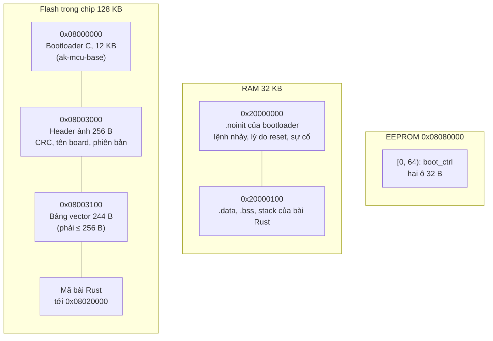
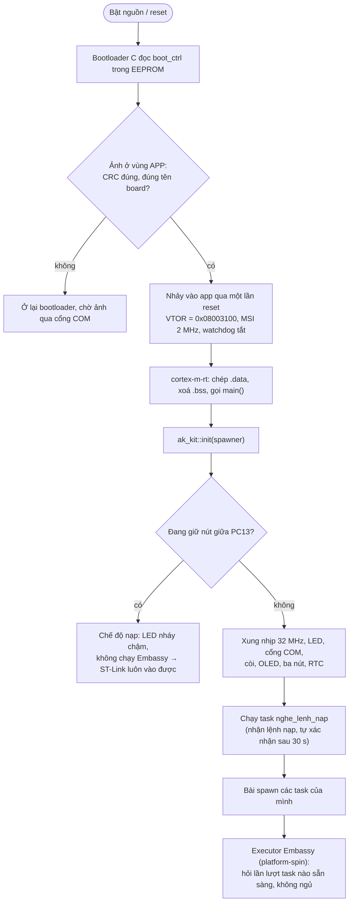
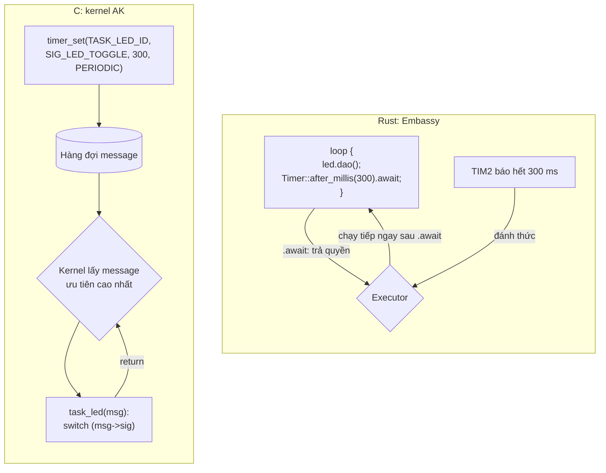
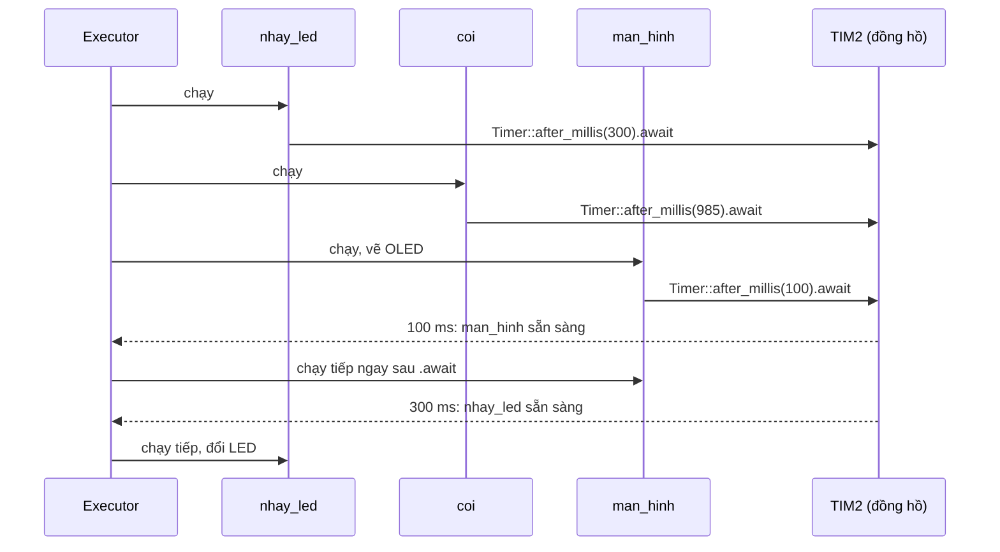
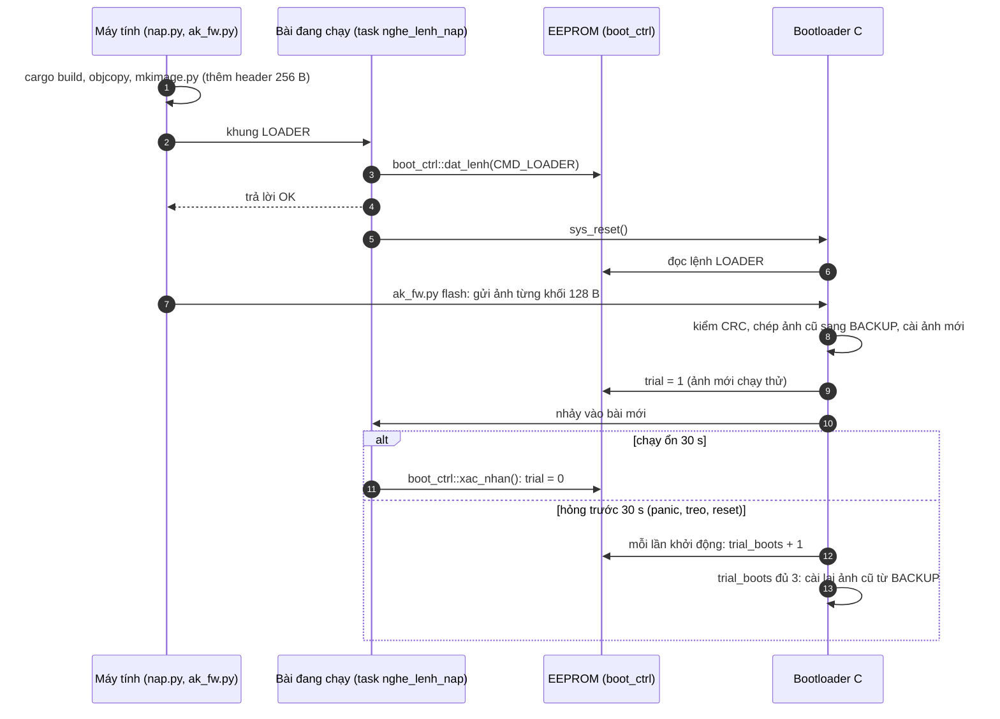
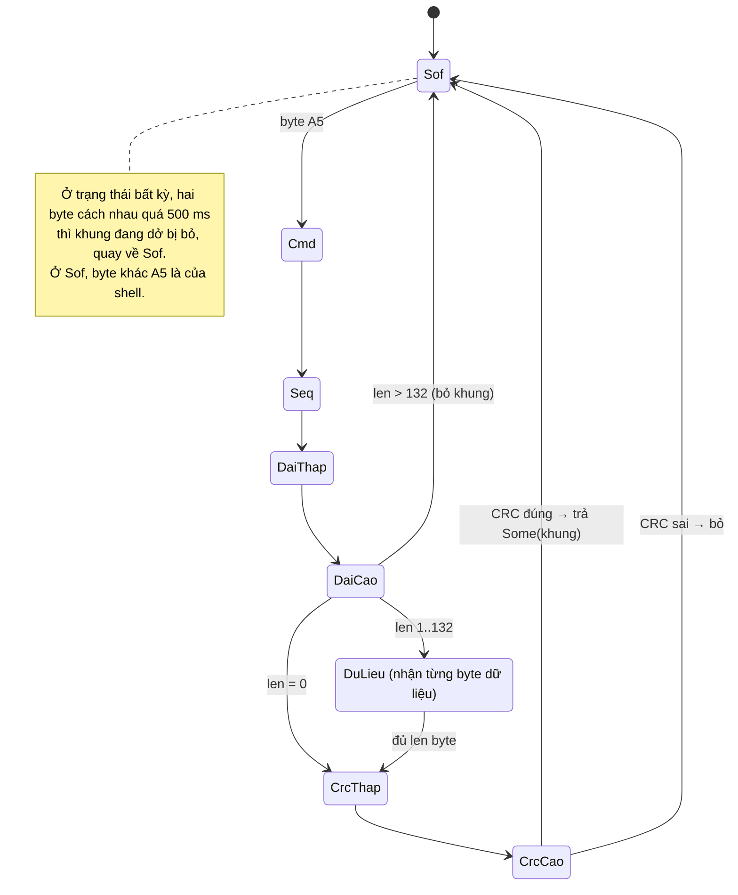
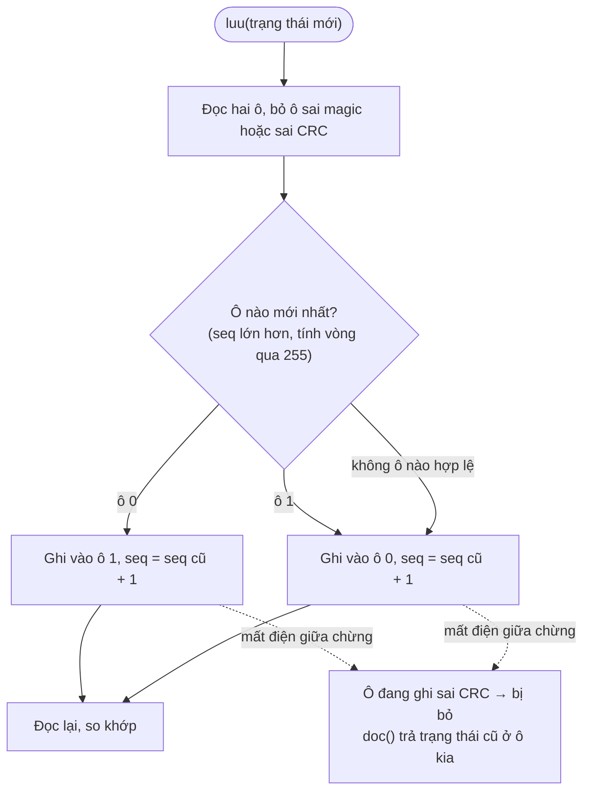
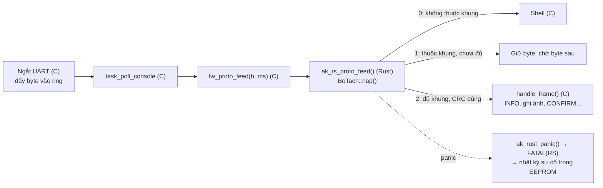
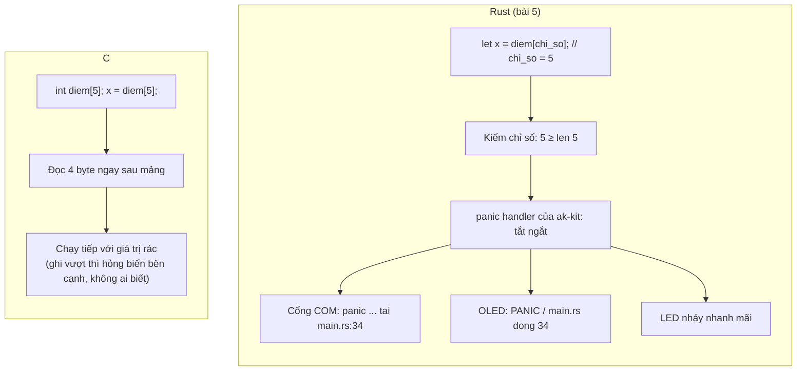
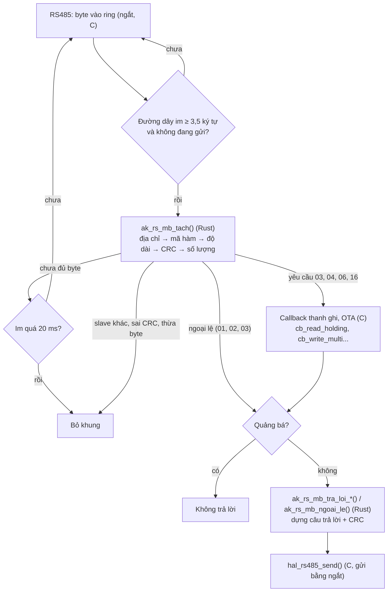

# Sơ đồ luồng chạy

Các sơ đồ dưới đây vẽ bằng [Mermaid](https://mermaid.js.org/): GitHub tự vẽ khi xem file. Muốn sửa thì sửa chữ trong
khối `mermaid`. Mỗi sơ đồ ghi tệp mã tương ứng để đối chiếu.

1. [Bộ nhớ: bootloader C và app Rust nằm ở đâu](#1-bộ-nhớ-bootloader-c-và-app-rust-nằm-ở-đâu)
2. [Từ lúc bật nguồn tới khi bài chạy](#2-từ-lúc-bật-nguồn-tới-khi-bài-chạy)
3. [Nhiều việc cùng lúc: kernel AK (C) và Embassy (Rust)](#3-nhiều-việc-cùng-lúc-kernel-ak-c-và-embassy-rust)
4. [Nạp bài mới qua cổng COM, chạy thử, quay lui](#4-nạp-bài-mới-qua-cổng-com-chạy-thử-quay-lui)
5. [Bộ tách khung `fw_proto`](#5-bộ-tách-khung-fw_proto)
6. [`boot_ctrl`: hai ô ghi xen kẽ, mất điện không mất trạng thái](#6-boot_ctrl-hai-ô-ghi-xen-kẽ-mất-điện-không-mất-trạng-thái)
7. [Rust nằm trong firmware C (`ak-ffi`)](#7-rust-nằm-trong-firmware-c-ak-ffi)
8. [Đọc vượt mảng: C chạy tiếp, Rust dừng đúng dòng](#8-đọc-vượt-mảng-c-chạy-tiếp-rust-dừng-đúng-dòng)
9. [Slave Modbus RTU với bộ tách yêu cầu Rust (`ak-modbus`)](#9-slave-modbus-rtu-với-bộ-tách-yêu-cầu-rust-ak-modbus)

## 1. Bộ nhớ: bootloader C và app Rust nằm ở đâu

Bài Rust không đè bootloader. Nó nằm trong vùng APP, nên nạp lại `app.img` của bản C lúc nào cũng được.

Mã: [`ak-kit/memory.x`](../ak-kit/memory.x), [`tools/kich_thuoc.py`](../tools/kich_thuoc.py) (CI kiểm bảng vector và
RAM mỗi lần push), [`ak-boot/src/boot_ctrl.rs`](../ak-boot/src/boot_ctrl.rs).

## 2. Từ lúc bật nguồn tới khi bài chạy

Mã: [`ak-kit/src/lib.rs`](../ak-kit/src/lib.rs) (`init`, `nut_giua_dang_giu`, `che_do_nap`), bài 1
[`hello-async/src/main.rs`](../hello-async/src/main.rs).

## 3. Nhiều việc cùng lúc: kernel AK (C) và Embassy (Rust)

Cả hai đều không có RTOS và chạy trên một lõi. Bên C, một việc nhiều bước bị chia thành signal và các lần gọi handler.
Bên Rust, cùng việc đó viết thành một vòng lặp đọc từ trên xuống; trình biên dịch tự cắt nó ở mỗi `.await`.

Trong một bài có ba việc (bài 2), các task thay nhau chạy như sau:

Mã: bài 2 [`ba-viec-cung-luc/src/main.rs`](../ba-viec-cung-luc/src/main.rs). So sánh chi tiết:
[rust-va-c.md mục 1.2](rust-va-c.md#12-nhiều-việc-cùng-lúc).

## 4. Nạp bài mới qua cổng COM, chạy thử, quay lui

`python tools/nap.py <bài> --com <cổng>` không cần ST-Link. Bài đang chạy (Rust hay C đều được) chỉ cần hiểu lệnh
LOADER; phần nhận và cài ảnh do bootloader C làm.

Mã: [`tools/nap.py`](../tools/nap.py), [`ak-kit/src/nap.rs`](../ak-kit/src/nap.rs),
[`ak-boot/src/boot_ctrl.rs`](../ak-boot/src/boot_ctrl.rs). Bootloader: `src/boot/boot_main.c` của ak-mcu-base. Đường
quay lui (nhánh `else`) chưa thử trên kit.

## 5. Bộ tách khung `fw_proto`

Khung: `A5 | cmd | seq | len (2 B) | dữ liệu | crc16 (2 B)`. Bộ tách nhận từng byte một. Byte nào không thuộc khung
(chữ gõ vào shell) thì để cho shell.

Mã: [`ak-boot/src/khung.rs`](../ak-boot/src/khung.rs). Test tính chất (byte rác, lật bit, im lặng 500 ms):
[`ak-boot/tests/tinh_chat.rs`](../ak-boot/tests/tinh_chat.rs).

## 6. `boot_ctrl`: hai ô ghi xen kẽ, mất điện không mất trạng thái

Mỗi lần lưu chỉ ghi vào ô **cũ hơn**, kèm `seq` tăng 1 và CRC-32. Mất điện giữa lúc ghi thì chỉ hỏng ô đang ghi; ô kia
vẫn giữ trạng thái trước đó.

Mã: [`ak-boot/src/boot_ctrl.rs`](../ak-boot/src/boot_ctrl.rs). Tính chất "mất điện ở byte bất kỳ" được kiểm với hàng
nghìn trạng thái ngẫu nhiên: [rust-va-c.md mục 1.5](rust-va-c.md#15-test-tính-chất-một-điều-phải-đúng-với-mọi-đầu-vào).

## 7. Rust nằm trong firmware C (`ak-ffi`)

Không viết lại gì. Bộ tách khung Rust ở mục 5 được biên dịch thành `libak_ffi.a` và link vào app C của ak-mcu-base
(tuỳ chọn `AK_RUST_PROTO`). Phía C gọi nó qua `extern "C"`; bootloader vẫn dùng bản C. Thư viện này còn mang bộ tách
yêu cầu Modbus (mục 9).

Chi phí: +312 B flash, +272 B RAM trên bản demo ([rust-va-c.md mục 2.2](rust-va-c.md#22-cùng-một-module-bộ-tách-khung-fw_proto)).
Mã: [`ak-ffi/src/lib.rs`](../ak-ffi/src/lib.rs), [`ak-ffi/include/ak_rs.h`](../ak-ffi/include/ak_rs.h); phía C:
`src/services/fw/fw_proto.c` của ak-mcu-base.

## 8. Đọc vượt mảng: C chạy tiếp, Rust dừng đúng dòng

Mã: bài 5 [`an-toan/src/main.rs`](../an-toan/src/main.rs), `panic` trong [`ak-kit/src/lib.rs`](../ak-kit/src/lib.rs).

## 9. Slave Modbus RTU với bộ tách yêu cầu Rust (`ak-modbus`)

Tuỳ chọn `AK_RUST_MODBUS` của ak-mcu-base: `mb_slave_poll()` đưa cả khung yêu cầu cho Rust thay vì gọi
`nmbs_server_poll()` của nanoMODBUS. Rust kiểm, C đọc/ghi thanh ghi, Rust dựng câu trả lời.

Mã: [`ak-modbus/src/lib.rs`](../ak-modbus/src/lib.rs), [`ak-ffi/src/lib.rs`](../ak-ffi/src/lib.rs); phía C:
`src/services/modbus/mb_slave.c` của ak-mcu-base. Số đo và phép so với nanoMODBUS:
[rust-va-c.md mục 2.3](rust-va-c.md#23-module-thứ-hai-tách-yêu-cầu-modbus-rtu-thay-nanomodbus).
